# AWAS: Smart Water Management and Billing System — Use Case Model

**System:** AWAS (Adlay Water Augmentation System) — Barangay Adlay
**Scope:** Membership application, meter reading, automatic billing, payments (Cash / GCash QR), reports, and the AWAS Assistant chatbot.

---

## 1. Actors

| Actor | Type | Description |
|---|---|---|
| **Guest / Applicant** | Primary | A member of the public who has no active account. Can apply for water service membership, verify their email, and track the status of their application. An existing consumer (already in the records with a meter number) can register an online login. |
| **Resident (Consumer)** | Primary | An approved household with an assigned water meter. Views bills, pays online through GCash QR, and checks consumption and payment history. |
| **Meter Reader (Staff)** | Primary | Barangay staff who goes house to house and records monthly meter readings. Bills are generated automatically from each reading. |
| **Administrator** | Primary | Water office personnel who manage consumers, review applications, verify payments, set tariffs, and generate reports. |
| **Email Service (Brevo)** | Secondary | Sends OTP codes and application notifications. |
| **AI Service (Claude API)** | Secondary | Optional fallback that answers chatbot questions not covered by the FAQ list. |

---

## 2. Use Case Diagram

```mermaid
flowchart LR
    Guest(["👤 Guest / Applicant"])
    Resident(["👤 Resident"])
    Reader(["👤 Meter Reader"])
    Admin(["👤 Administrator"])
    Email(["🖥 Email Service"])
    AI(["🖥 AI Service"])

    subgraph AWAS["AWAS Smart Water Management and Billing System"]
        UC1((UC-01 Apply for Membership))
        UC2((UC-02 Verify Email via OTP))
        UC3((UC-03 Track Application Status))
        UC4((UC-04 Log In / Log Out))
        UC5((UC-05 Reset / Change Password))
        UC6((UC-06 View Dashboard))
        UC7((UC-07 View Current Bill))
        UC8((UC-08 Pay Bill Online via GCash QR))
        UC9((UC-09 View Billing, Payment & Consumption History))
        UC10((UC-10 Print Bill / Download Receipt))
        UC11((UC-11 Update Contact Information))
        UC12((UC-12 Ask AWAS Assistant))
        UC13((UC-13 Record Meter Reading))
        UC14((UC-14 Generate Water Bill))
        UC15((UC-15 View Consumers List))
        UC16((UC-16 Review Membership Application))
        UC17((UC-17 Assign Meter & Activate Account))
        UC18((UC-18 Manage Consumers))
        UC19((UC-19 Correct Meter Reading))
        UC20((UC-20 Record Counter Payment))
        UC21((UC-21 Verify / Reject Online Payment))
        UC22((UC-22 Manage Billing Rates & Settings))
        UC23((UC-23 Manage Puroks))
        UC24((UC-24 Manage User Accounts))
        UC25((UC-25 Manage Chatbot FAQs))
        UC26((UC-26 Generate & Export Reports))
        UC27((UC-27 View Activity Logs))
        UC28((UC-28 Flag Overdue Bills))
        UC29((UC-29 Register Online Account))
    end

    Guest --- UC1
    Guest --- UC29
    Guest --- UC3
    Guest --- UC4
    Guest --- UC5
    UC1 -. include .-> UC2
    UC29 -. include .-> UC2

    Resident --- UC4
    Resident --- UC5
    Resident --- UC6
    Resident --- UC7
    Resident --- UC8
    Resident --- UC9
    Resident --- UC10
    Resident --- UC11
    Resident --- UC12

    Reader --- UC4
    Reader --- UC6
    Reader --- UC13
    Reader --- UC15
    Reader --- UC26
    Reader --- UC27
    UC13 -. include .-> UC14

    Admin --- UC4
    Admin --- UC6
    Admin --- UC10
    Admin --- UC16
    Admin --- UC17
    Admin --- UC18
    Admin --- UC19
    Admin --- UC20
    Admin --- UC21
    Admin --- UC22
    Admin --- UC23
    Admin --- UC24
    Admin --- UC25
    Admin --- UC26
    Admin --- UC27
    UC16 -. extend .-> UC17
    UC19 -. include .-> UC14
    UC6 -. include .-> UC28
    UC7 -. include .-> UC28

    UC2 --- Email
    UC5 --- Email
    UC16 --- Email
    UC17 --- Email
    UC12 --- AI
```

---

## 3. Use Case Summary

| ID | Use Case | Actor(s) | Description |
|---|---|---|---|
| UC-01 | Apply for Membership | Guest | Submits personal details, purok, valid ID image, and a live face capture (liveness check). |
| UC-02 | Verify Email via OTP | Guest, Email Service | Enters the 6-digit emailed code (included in UC-01 and UC-29). After applying, the application moves to *Pending review*; after registering, the login is activated. |
| UC-03 | Track Application Status | Applicant | Logs in and sees whether the application is pending, approved, rejected, or active. |
| UC-04 | Log In / Log Out | All users | Authenticates and is routed to the role's dashboard; idle sessions are signed out after 30 minutes. |
| UC-05 | Reset / Change Password | All users, Email Service | Resets a forgotten password or changes it while signed in, both confirmed with an emailed code. |
| UC-06 | View Dashboard | Resident, Meter Reader, Admin | Shows role-specific summaries (balance, readings to do, collections, pending items). |
| UC-07 | View Current Bill | Resident | Shows unpaid bills, amount due, due date, and disconnection date. |
| UC-08 | Pay Bill Online via GCash QR | Resident | Scans the barangay GCash QR, then submits the GCash reference number and receipt image. |
| UC-09 | View History | Resident | Lists past bills, payments, and monthly water consumption. |
| UC-10 | Print Bill / Download Receipt | Resident, Admin | Prints a bill or views a payment receipt (residents only their own). |
| UC-11 | Update Contact Information | Resident | Edits contact number and other allowed profile details. |
| UC-12 | Ask AWAS Assistant | Resident, AI Service | Chatbot answers balance/due-date questions and FAQs, with optional AI fallback. |
| UC-13 | Record Meter Reading | Meter Reader | Looks up a meter number and enters the present reading for a billing period. |
| UC-14 | Generate Water Bill | System | Computes and saves the bill automatically from the reading (included in UC-13 and UC-19). |
| UC-15 | View Consumers List | Meter Reader, Admin | Searches consumers by name, meter number, or purok. |
| UC-16 | Review Membership Application | Admin, Email Service | Checks the ID and face images, sets verification status, approves or rejects. |
| UC-17 | Assign Meter & Activate Account | Admin, Email Service | Assigns a meter number and initial reading; the applicant becomes a Resident. |
| UC-18 | Manage Consumers | Admin | Adds, edits, deletes consumers and views each consumer's history. |
| UC-19 | Correct Meter Reading | Admin | Fixes a wrong reading; the bill is recomputed unless payments already exist. |
| UC-20 | Record Counter Payment | Admin | Records a walk-in Cash or GCash QR payment at the barangay office. |
| UC-21 | Verify / Reject Online Payment | Admin | Confirms a resident's GCash payment (updates the bill) or rejects it with a reason. |
| UC-22 | Manage Billing Rates & Settings | Admin | Sets minimum charge, included cu. m., excess rate, senior discount, due day, penalties, and the GCash QR. |
| UC-23 | Manage Puroks | Admin | Adds, renames, and removes puroks (zones). |
| UC-24 | Manage User Accounts | Admin | Creates staff/admin accounts, activates/deactivates users, resets passwords. |
| UC-25 | Manage Chatbot FAQs | Admin | Maintains FAQ answers, reviews unanswered questions, configures the AI fallback. |
| UC-26 | Generate & Export Reports | Admin, Meter Reader | Billing by purok, consumption, paid/unpaid/overdue, collections, consumers, readings; print or export. |
| UC-27 | View Activity Logs | Admin, Meter Reader | Admins see everyone's activity; Meter Readers see only their own. |
| UC-28 | Flag Overdue Bills | System | Marks bills past the due date plus grace period as *Overdue* and adds the penalty. Runs automatically whenever a dashboard or bill list is opened (included in UC-06 and UC-07) and after a reading is corrected. |
| UC-29 | Register Online Account | Guest, Email Service | An existing consumer creates a login by matching their meter number, full name, and purok, then verifies their email (includes UC-02). |

---

## 4. Detailed Use Case Descriptions

### UC-01 — Apply for Membership

| Field | Details |
|---|---|
| **Primary Actor** | Guest |
| **Secondary Actor** | Email Service |
| **Goal** | Request a water service connection from Barangay Adlay. |
| **Preconditions** | The guest is not logged in and has a valid email address. |
| **Postconditions** | An application with a reference code is saved with status *Pending verification*, and an OTP is emailed. |

**Main Flow**
1. Guest opens the **Apply** page.
2. System displays the membership application form.
3. Guest enters full name, address, purok, contact number, email, consumer type, and password.
4. Guest selects an ID type and uploads a photo of a valid ID.
5. Guest performs the live face capture (liveness check).
6. Guest submits the form.
7. System validates the input and files, then creates an applicant account and the application record.
8. System generates a reference code and emails a verification code (**include UC-02**).
9. System redirects the guest to the email verification page.

**Alternative / Exception Flows**
- **7a. Invalid input or file:** System shows the errors and asks the guest to re-attach the files.
- **7b. Email already used by an active account:** System rejects the submission.
- **7c. Email belongs to an unfinished pending applicant:** System replaces the stale application.
- **5a. Liveness check skipped or unsupported:** The application is saved with liveness *not performed* for the administrator to consider.

---

### UC-08 — Pay Bill Online via GCash QR

| Field | Details |
|---|---|
| **Primary Actor** | Resident |
| **Goal** | Pay a water bill without going to the barangay office. |
| **Preconditions** | Resident is logged in and has an unpaid, partially paid, or overdue bill with no pending payment. |
| **Postconditions** | A payment with status *Pending* is saved and waits for administrator verification (UC-21). |

**Main Flow**
1. Resident opens **My Bill** and clicks **Pay** on a bill.
2. System shows the bill balance and the barangay's official GCash QR code.
3. Resident scans the QR with the GCash app and pays the amount.
4. Resident enters the 13-digit GCash reference number and uploads the receipt screenshot.
5. Resident submits the payment.
6. System validates the reference (format and not previously used) and saves the payment as *Pending*.
7. System shows a confirmation with the payment reference (PMT-YYYY-######).

**Alternative / Exception Flows**
- **1a. Bill already paid:** System shows "This bill is already paid."
- **1b. A payment is already pending for the bill:** System tells the resident to wait for verification.
- **6a. Reference invalid or already used:** System shows an error and the resident corrects it.

---

### UC-13 — Record Meter Reading (includes UC-14 Generate Water Bill)

| Field | Details |
|---|---|
| **Primary Actor** | Meter Reader |
| **Goal** | Record a household's monthly water meter reading so it can be billed. |
| **Preconditions** | Meter Reader is logged in; the consumer's account is active. |
| **Postconditions** | The reading and its water bill are saved; administrators are notified; the activity is logged. |

**Main Flow**
1. Meter Reader opens **Meter Readings** and enters the meter number.
2. System looks up the consumer and shows the name, purok, type, and previous reading.
3. Meter Reader selects the billing period and enters the present reading and optional remarks.
4. System shows a live preview of the computed bill.
5. Meter Reader saves the reading.
6. System validates and saves the reading.
7. System generates the bill (**UC-14**):
   - Consumption = present − previous
   - Sub-total = minimum charge + (excess cu. m. × excess rate)
   - Senior discount applied if the consumer is a senior citizen
   - Due date and disconnection date are set from the settings
8. System notifies administrators and confirms the saved consumption and amount.

**Alternative / Exception Flows**
- **2a. Meter number not found or not numeric:** System shows an error.
- **2b. Account not active:** System refuses to record the reading.
- **6a. Present reading lower than previous, or negative:** System shows an error.
- **6b. A reading already exists for that period:** System rejects the duplicate.

---

### UC-16 — Review Membership Application (extended by UC-17)

| Field | Details |
|---|---|
| **Primary Actor** | Administrator |
| **Secondary Actor** | Email Service |
| **Goal** | Decide whether an applicant may become a water consumer. |
| **Preconditions** | The application status is *Pending review* (email already verified). |
| **Postconditions** | The application is *Approved* (awaiting meter) or *Rejected*, and the action is logged. |

**Main Flow**
1. Administrator opens **Applications** (filtered to *Pending review* by default).
2. Administrator selects an application.
3. System shows the applicant's details, ID image, face capture, and liveness result.
4. Administrator sets the ID and face verification statuses.
5. Administrator clicks **Approve**.
6. System marks the application *Approved — awaiting meter* and records the reviewer.
7. Administrator proceeds to **UC-17 Assign Meter & Activate Account**.

**Alternative Flow — Reject**
- **5a.** Administrator clicks **Reject** and enters a reason.
- **5b.** System marks the application *Rejected* and emails the reason to the applicant.

---

### UC-17 — Assign Meter & Activate Account

| Field | Details |
|---|---|
| **Primary Actor** | Administrator |
| **Goal** | Connect an approved applicant to a water meter. |
| **Preconditions** | The application status is *Approved*. |
| **Postconditions** | A consumer record is created, the user's role becomes *Resident*, and an approval email is sent. |

**Main Flow**
1. Administrator enters the meter number, installation date, initial reading, meter status, and household number.
2. System validates the data and checks that the meter number is unique.
3. System creates the consumer record, marks the application *Active*, and upgrades the account to *Resident*.
4. System emails the applicant that the account is active.

**Exception Flows**
- **2a. Duplicate meter number:** System shows an error.
- **3a. Application no longer *Approved*:** System cancels the action.

---

### UC-21 — Verify / Reject Online Payment

| Field | Details |
|---|---|
| **Primary Actor** | Administrator |
| **Goal** | Confirm that an online GCash payment was actually received. |
| **Preconditions** | A payment with status *Pending* exists. |
| **Postconditions** | The payment is *Verified* and the bill balance and status are updated, or the payment is *Rejected* and the resident is notified. |

**Main Flow**
1. Administrator opens **Payments → Pending**.
2. Administrator views the receipt image and checks the GCash reference against the barangay's GCash account.
3. Administrator clicks **Verify**.
4. System marks the payment *Verified*, adds the amount to the bill, and sets the bill to *Paid* or *Partially paid*.
5. System notifies the resident.

**Alternative Flow — Reject**
- **3a.** Administrator clicks **Reject** and enters a reason.
- **3b.** System marks the payment *Rejected* and notifies the resident, who may pay again.

---

### UC-20 — Record Counter Payment

| Field | Details |
|---|---|
| **Primary Actor** | Administrator |
| **Goal** | Record a walk-in payment made at the barangay office. |
| **Preconditions** | The bill has an outstanding balance and no pending online payment. |
| **Postconditions** | A *Verified* payment is saved and the bill is updated immediately. |

**Main Flow**
1. Administrator opens **Payments** and selects an unpaid bill.
2. Administrator chooses the method (Cash or GCash QR), enters the amount, reference, and remarks.
3. System validates and saves the payment as verified.
4. System updates the bill balance and status and shows a success message.

---

### UC-12 — Ask AWAS Assistant

| Field | Details |
|---|---|
| **Primary Actor** | Resident |
| **Secondary Actor** | AI Service (optional) |
| **Goal** | Get quick answers about bills and water service. |
| **Preconditions** | Resident is logged in. |
| **Postconditions** | An answer is shown; unanswered questions are saved for the administrator. |

**Main Flow**
1. Resident types a question in the chatbot widget.
2. System detects the intent (e.g., balance, due date, last reading) and answers from the resident's own records.
3. If no personal intent matches, System searches the FAQ list and returns the best answer.

**Alternative Flows**
- **2a. Request to perform a restricted action (e.g., delete a bill):** System politely declines.
- **3a. No FAQ match and AI fallback enabled:** System asks the AI Service using FAQ excerpts as context.
- **3b. No answer found:** System saves the question as unanswered for review in UC-25.

---

### UC-28 — Flag Overdue Bills

| Field | Details |
|---|---|
| **Primary Actor** | None — runs automatically (included in UC-06 and UC-07) |
| **Goal** | Keep bill statuses and penalties up to date. |
| **Trigger** | A dashboard, the current bill page, the bills list, or the meter readings list is opened, or a reading is corrected (UC-19). There is no scheduled job. |
| **Postconditions** | Late bills are marked *Overdue* with the penalty added. |

**Main Flow**
1. System finds unpaid or partially paid bills whose due date plus the grace period has passed.
2. System computes the penalty as the payable amount × the rate's penalty percentage.
3. System sets the bill status to *Overdue* and updates the total amount.

---

### UC-29 — Register Online Account (includes UC-02)

| Field | Details |
|---|---|
| **Primary Actor** | Guest (existing consumer) |
| **Secondary Actor** | Email Service |
| **Goal** | Give an existing water consumer an online login without a new membership application. |
| **Preconditions** | The consumer is already in the records with a meter number, and the record is not yet linked to a login. |
| **Postconditions** | A *Resident* login is created and linked to the consumer record, and becomes active once the email is verified. |

**Main Flow**
1. Guest opens **Create Account** from the home or login page.
2. Guest enters meter number, full name, purok, consumer type, email, contact number, username, and password.
3. System checks that the meter number exists and that the full name and purok match the records.
4. System creates a pending Resident login and links it to the consumer record.
5. System emails a verification code (**include UC-02**); after the code is entered, the account is active.

**Alternative / Exception Flows**
- **3a. Meter number not found, or name/purok do not match:** System shows an error and tells the guest to contact the barangay water office.
- **3b. Consumer already linked to an active login:** System tells the guest to sign in instead.
- **3c. Linked login was never verified:** System removes the stale login and continues.
- **3d. Username already taken or password too weak:** System shows the error.
